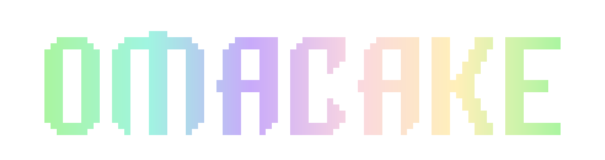
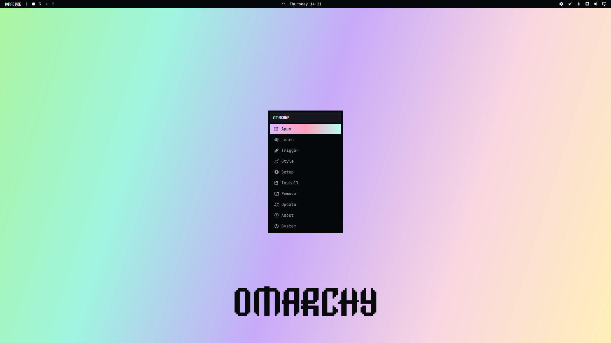
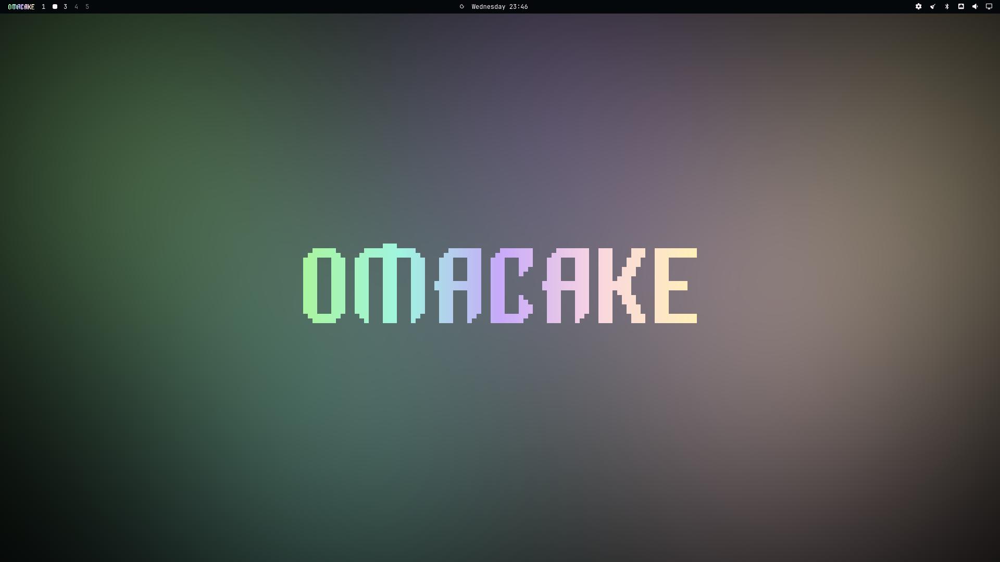
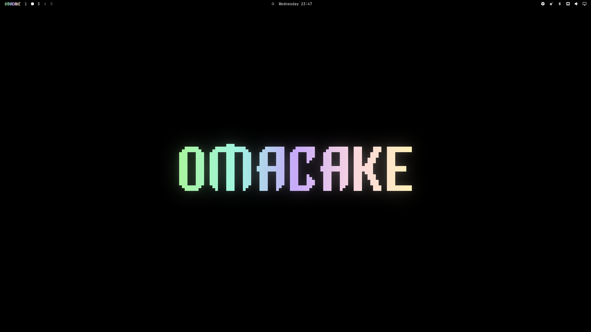
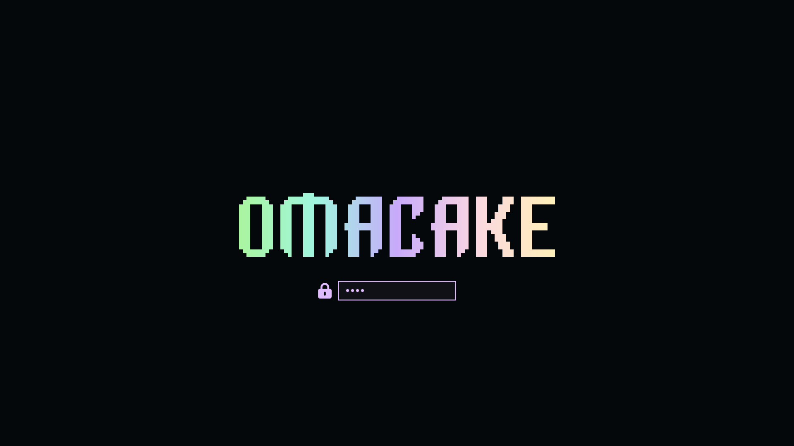

<p align="center">
  
</p>

# Omacake

A minimalist, high-contrast dark theme engineered natively for **Omarchy** and **Hyprland**. Built around deep obsidian foundations, delicate pastel gradients, and refined interface geometry for the modern Wayland desktop.

<p align="center">
  
</p>

<p align="center">
  
  
</p>

<p align="center">
  
</p>

---

## Design & Architecture

Omacake balances absolute black surfaces with soft pastel accents. Deep obsidian foundations maximize visual contrast on modern displays, while subtle gradient borders and pill-style selection indicators provide focused visual feedback without interface noise.

### Highlights

- **Obsidian Foundations**: High-contrast, pure dark surfaces (`#05080A`) paired with soft pearl typography (`#FFF6FF`) for crisp hierarchy and minimal ocular fatigue.
- **Compositor Integration**: Three-stop animated gradient active window borders (`#DFBAFF` to `#FF9FBC` to `#B2FFF3`), paired with calibrated drop shadows.
- **Dynamic Surface Geometry**: Real-time synchronization between compositor window rounding and launcher surface curvature, ensuring unified corner geometry across floating windows and panels.
- **Native Shell Layout**: Borderless container surfaces, custom vertical row spacing, and pill-shaped selection highlights built natively for Omarchy Shell and Quickshell.
- **Configurable Start Badges**: Multiple status bar brand assets including a transparent gradient wordmark, rounded pill badge, and rectangular mark.
- **Curated 4K Wallpapers**: Bundled high-resolution dark-mode wallpapers calibrated to harmonize with the theme palette.
- **Unified Application Coverage**: Pre-configured styling tokens for system monitoring (`btop`), audio visualization (`cava`), GTK applications, Chromium, and lockscreen surfaces (`hyprlock`).

---

## Installation

### Using the Omarchy CLI

Install and activate the theme directly using the Omarchy package manager:

```bash
omarchy theme install https://github.com/FGod47/omarchy-omacake-theme.git
```

### Manual Installation

Clone the repository into your local Omarchy themes directory and apply it:

```bash
git clone https://github.com/FGod47/omarchy-omacake-theme.git ~/.config/omarchy/themes/omacake
omarchy theme set omacake
```

To cycle through the included wallpapers:

```bash
omarchy theme bg next
```

---

## Configuration

### Status Bar Logo

Omacake supports multiple start button styles via `shell.toml`. Under the `[menu]` section, set the `logo` key to your preferred variant:

```toml
[menu]
logo = "omacake"       # Clean transparent gradient wordmark (default)
# logo = "omacake-pill"  # Rounded pill badge
# logo = "omacake-rect"  # Rectangular badge
```

---

## License

This project is licensed under the [MIT License](LICENSE).
